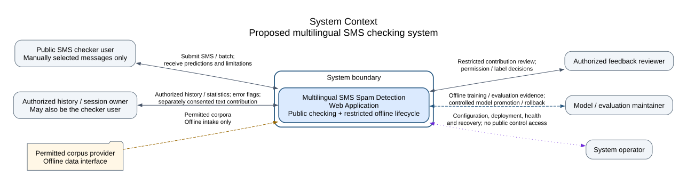
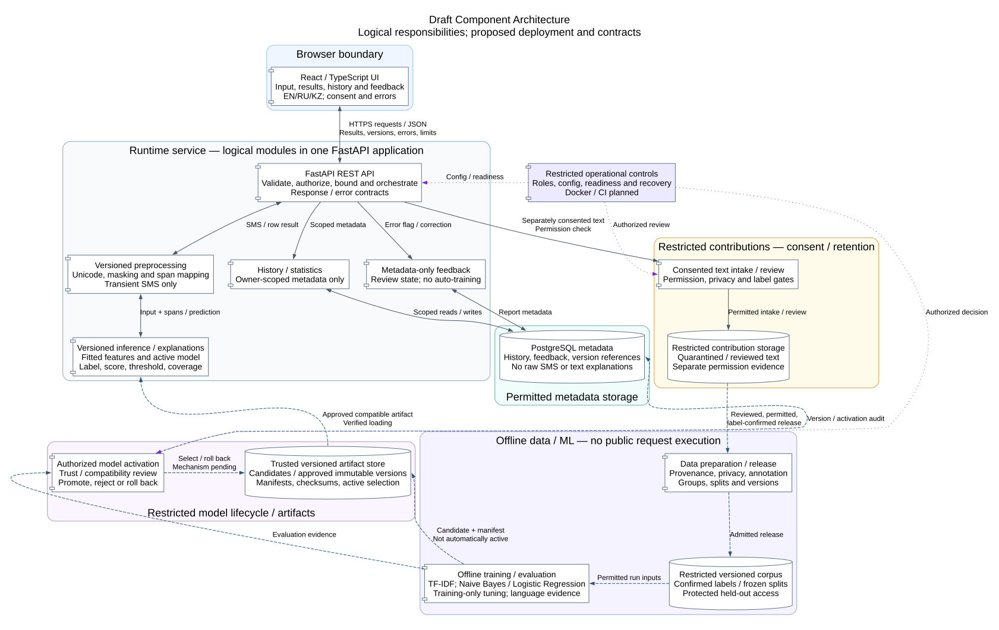

# System Context and Draft Component Architecture

## 1. Purpose and architectural scope

This initial architecture describes the proposed multilingual SMS checking system for the first pre-defense. It refines the [Requirements Specification](requirements.md) and [Project Proposal](project_proposal.md) into system boundaries, logical components and data flows. It establishes design intent, not implemented services, measured performance or completed evaluation.

The system includes a public browser checker, owner-scoped history/statistics, restricted feedback handling and an offline data/model lifecycle. These are parts of one project boundary even though the browser, runtime service and offline activities have different execution and trust boundaries. Logical components do not imply separately deployed microservices. Offline work may initially be authorized scripts and controlled artifacts rather than an administrative web application.

Users manually submit selected SMS or batches. Automatic inbox access, interception, carrier blocking, external URL fetching, message-content execution and guaranteed fraud prevention remain outside scope. No carrier, banking, paid gateway or external inference API is required by this design.

## 2. Architectural drivers

- **Consistent multilingual results:** preserve Unicode and distinguish UI locale, message-language evidence and evaluated model coverage; unsupported cases need an explicit outcome.
- **Faithful explanations:** preprocessing, feature contributions, threshold and confidence interpretation must correspond to the version actually used. A probability is not proof of safety or automatically calibrated confidence.
- **Privacy and ownership:** separate transient text from permitted history metadata and separately consented contributions; authorize queries and restricted decisions at the service boundary.
- **Reliable integration:** validate both request and response contracts, bound resources, account for batch rows and handle failures without fabricated predictions or false persistence confirmations.
- **Reproducible model lifecycle:** preserve data/split/feature/model versions, evaluate without leakage, and promote only trusted compatible candidates with rollback.

These drivers follow Proposal objectives O-03–O-08 and requirements FR-01–FR-23, NFR-01–NFR-22 and EV-01. D-01–D-08 remain open; diagrams do not settle their missing contracts or quantitative targets.

## 3. System Context

[Editable System Context source](../diagrams/system_context.dot)

The application is represented as a single system inside an explicit system boundary. Its external roles are the public checker user, authorized history/session owner, feedback reviewer, model/evaluation maintainer and system operator. One person can occupy multiple roles; the labels describe permissions, not separate mandatory accounts. A generic permitted corpus provider represents an offline data interface, not a newly contracted organization.

The public checker exchanges manually submitted text/files and results with limitations. The owner accesses permitted history/statistics and submits error reports or, separately, a consented text contribution. Reviewers assess restricted contributions; maintainers conduct offline runs and model decisions; operators configure, deploy, monitor and recover the system. The provider's arrow is offline intake only. Two-headed edges represent a conceptual exchange, not a grant of unrestricted access in either direction.

FastAPI, PostgreSQL and model modules are internal implementation choices and therefore are not external systems on this diagram. The offline lifecycle remains within the same project scope as the runtime checker.

## 4. Component architecture

[Editable Component source](../diagrams/component.dot)

Solid edges describe runtime requests/results or storage access; dashed blue edges describe controlled offline data/model transfer and artifact loading; dotted purple edges describe restricted decisions and operational dependencies. Labels carry the meaning independently of color. Arrows show allowed logical dependencies, not implemented endpoints. Replies on internal calls may be omitted; the UI/API exchange and inference response are shown explicitly.

### 4.1. Browser and runtime service

**React/TypeScript UI:** single SMS, batch selection, language choice, safe result/highlight rendering, history/statistics and feedback/consent states. A shared API adapter should verify HTTP outcomes and runtime response structures, correlate results to input and suppress stale responses. SMS remains transient UI state by default; browser storage, analytics and error reporting must not silently retain it. The frontend neither classifies locally nor accesses the database or artifact store directly.

**FastAPI boundary/orchestration:** decoding/schema validation, owner/role authorization, request/file limits, rate/concurrency enforcement, single/batch coordination and consistent errors. Concrete routes, schemas, cookies/tokens, CORS/CSRF settings and limits are pending. Validation is authoritative on the server even if the UI offers early checks. Merely selecting FastAPI does not supply the complete security policy.

**Versioned preprocessing:** Unicode handling, deterministic privacy transformation and model-input normalization consistent with the [Dataset Strategy](dataset_strategy.md), including its Sections 8–10 and 20. Transient span mappings connect displayed text to actual word/character features without revealing protected spans. Script alone does not establish language; preprocessing must not silently translate messages or choose language coverage from the UI locale.

**Inference/explanations:** load a trusted compatible fitted feature extractor/classifier and apply its documented score/threshold rule. Return label, probability, confidence interpretation, faithful feature-based explanation, effective versions and coverage limitations. A fixed suspicious-word list is not an explanation method. Invalid mappings or unevaluated cases require explicit limitations/failures under the agreed contract. Training does not execute inside prediction requests.

**History/statistics and feedback services:** enforce owner-scoped queries, allowlisted metadata and meaningful version references. Rafael owns their behavior; Sanzhar owns persistence/API integration; Beknur owns the screens. Statistics describe stored predictions, not evaluated precision or recall. Metadata-only error reports never become training examples by themselves.

### 4.2. Storage, restricted contributions and offline work

**PostgreSQL:** permitted prediction identifiers, authorized scope, timestamps, label/score/threshold metadata, model/preprocessing references and feedback/review lifecycle metadata. Raw personal SMS, full URLs, sender details and text-bearing explanations are excluded from ordinary history by default. Database roles/constraints and optional row policies supplement application authorization; their concrete design remains pending.

**Contribution gate and restricted storage:** separate consent and permitted-use evidence from ordinary history, hold permitted intake in quarantine, apply privacy screening and record independent label decisions before release. Permission evidence is logically segregated from working text. A metadata error flag is insufficient consent. Review follows the [Annotation Guidelines](annotation_guidelines.md), including unresolved cases, reviewer competence and independent adjudication; a public correction is not verified ground truth.

**Data preparation/release and restricted corpus:** admitted sources and consented examples enter versioned preparation, privacy review, annotation/agreement and grouping. Preserve provenance, permissions, frozen split manifests and held-out access controls. The contribution-to-data arrow is gated release, not direct UI-to-training ingestion. Source acquisition is authorized offline intake; unknown native RU/KZ availability remains a limitation.

**Offline training/evaluation:** Rafael integrates TF-IDF and the planned Naive Bayes/Logistic Regression comparison using training-only fitting/tuning and protected evaluation boundaries. Dataset/split, preprocessing, parameters and dependency versions accompany actual runs. EV-01 requires versioned evidence with native-message support counts, confusion matrices and per-language spam precision/recall/F1, including mixed-language and undefined cases. No measurements or final algorithm selection are established here.

**Artifact store and promotion gate:** candidates, manifests, checksums and previously approved versions remain separate from PostgreSQL history. A candidate is not active merely because training wrote it. Review checks evaluation evidence, trusted origin and compatibility before an authorized promotion; incompatible/untrusted artifacts are rejected. Public clients cannot submit serialized models for loading. Active selection, worker readiness and rollback must preserve the version actually used by each response. The activation mechanism is pending D-07; a PostgreSQL transaction alone cannot atomically publish an external file and switch all workers.

### 4.3. Operational responsibility

Restricted operational controls cover secrets/configuration, HTTPS, trusted connectivity, bounded execution, health/readiness, migrations, retention/deletion and recovery. Docker/CI are planned delivery mechanisms rather than existing infrastructure. No provider, physical topology, availability promise or workload capacity is selected here. An authorized role may configure the service or run offline operations through a future agreed mechanism; the diagram does not introduce a public training endpoint or require an admin dashboard.

Sanzhar leads API/system integration, inference/explanations, privacy, persistence, Docker/CI/deployment and API tests. Beknur leads UI/i18n, data preparation/annotation, character features, batch/history/feedback screens, accessibility/usability and the separate Use Case work. Rafael leads training/evaluation, versions, history/statistics/feedback/retraining behavior and general testing. All supply their technical documentation and review; Beknur leads unified-report assembly. These are responsibility boundaries, not claims of completed contributions.

## 5. Main interactions and data flows

| Scenario | Components and flow | Sensitive data / trust boundary | Requirement basis / pending decisions |
|---|---|---|---|
| Single-message checking | UI -> API -> preprocessing -> inference -> API -> UI; optional permitted metadata write through history service | Raw text crosses HTTPS transiently; response explanations may contain submitted fragments, so they are excluded from default history/logging | FR-01–FR-05, FR-18–FR-22; D-02/D-03/D-04/D-06 |
| Batch checking | UI file -> bounded API parsing -> same preprocessing/inference per accepted row -> correlated result or row error | File and row text are transient; quoted newlines, invalid records and file-level failures need distinct accounting and cleanup | FR-06/FR-07, NFR-07/NFR-10; D-04/D-05/D-06 |
| Authorized history/statistics | Owner request -> API authorization -> history service -> PostgreSQL scoped records/aggregation -> UI | Scope applies to list/detail/counts before data is exposed; no raw-text history or reconstructed explanations | FR-10–FR-12/FR-23, NFR-03; D-02/D-04/D-05 |
| Metadata-only feedback | Authorized owner -> API -> feedback service -> PostgreSQL report/review metadata | No text retained by implication and no automatic model update | FR-13/FR-15; D-02/D-04/D-05 |
| Consented text contribution | Separate UI consent -> API restricted intake -> gate/quarantine -> privacy and label review -> controlled release to data preparation | Permitted text and permission evidence use restricted, segregated access/retention; unconfirmed or privacy-failed items do not enter training | FR-14–FR-16, NFR-04/NFR-05; D-02/D-05 |
| Offline evaluation and model change | Versioned corpus -> offline run -> candidate artifact + evidence -> authorized promotion gate -> approved artifact selection -> verified runtime loading | Held-out data remains controlled; artifacts may reveal training vocabulary; promotion/rollback never follows a public correction automatically | FR-16/FR-17/FR-21/FR-22, NFR-17/NFR-18, EV-01; D-03/D-07 |

Single/batch responses must identify the score interpretation and effective model/preprocessing/threshold/explanation configuration. If persistence fails, the agreed response must distinguish a computed prediction from saved history; never promise persistence falsely. Resource controls must account for CPU-bound inference, per-worker model memory and database connections. Execution strategy, limits, cancellation and retry/idempotency rules remain pending, without introducing arbitrary numeric targets.

## 6. Privacy, security and trust boundaries

The browser is untrusted for authorization, limits and model decisions. Render message content as text, not HTML; never execute it or follow its links. Keep UI locale separate from message language and actual coverage. UI validation and TypeScript types do not establish trusted API payloads.

The API must scope every history, statistics, feedback and deletion operation to the authorized role/owner. Opaque IDs and message hashes are not evidence of anonymity or authority. Rate-limiting identifiers need a minimized retention policy. Error bodies, validation diagnostics, access logs, telemetry, temporary files and backups share the retention/privacy constraints of primary stores; masking alone is not an anonymization guarantee.

Ordinary prediction may process raw text transiently but has no default path for copying it into history. Separately consented contributions have a different trust/retention boundary and require privacy review, label confirmation and permitted-use checks before controlled training release. Retention/withdrawal must propagate to active data releases and recovery procedures as agreed; effects on existing models remain an explicit unresolved question.

Offline training and artifact promotion require restricted authority independent of public prediction. Training-only transformations, group-aware splitting and protected held-out evaluation prevent the architecture from treating public feedback as a direct online-learning signal. Dependency and checksum checks support trusted artifact loading, but do not replace origin, privacy and compatibility review. Worker activation and recovery require a reviewed protocol before deployment acceptance.

## 7. Technology rationale

The [Technology Comparison](technology_comparison.md), Sections 2–5, recommends React/TypeScript for separated multilingual views, FastAPI for documented Python contracts and PostgreSQL for related permitted metadata. The architecture accepts their integration and operational costs; no speed, cost or security superiority is inferred.

Python/scikit-learn, TF-IDF and Naive Bayes/Logistic Regression are the planned experiment path in the Proposal and Dataset Strategy. A fitted preprocessing/feature/classifier configuration must be handed off as one compatible versioned contract. Final estimator, threshold, calibration, explanation method and pooled-versus-language-specific routing await Rafael's substantive analysis and team review. Backend and UI choices cannot establish native RU/KZ evaluation quality.

## 8. Requirements traceability

All 46 requirements/evidence obligations below are mapped. Quality constraints may require checks across several components rather than a dedicated box; no new app feature is implied by EV-01. Flow names refer to Section 5. Diagram node names match the logical components in Section 4.

| Requirement IDs | Architectural element | Flow / verification implication | Security or privacy implication | Pending dependency |
|---|---|---|---|---|
| FR-01, FR-02, FR-03 | UI, API, inference | Single checking; label/score/threshold and confidence agreement | No safety guarantee or assumed calibration | D-03, D-04 |
| FR-04, FR-05 | Preprocessing, inference, UI highlights | Feature contribution / Unicode span fixtures | No invented highlights or protected-span disclosure | D-03, D-04 |
| FR-06, FR-07, FR-18 | UI, API batch orchestration, preprocessing | Bounded CSV/UTF-8 parsing; row accounting and errors | Reject unsupported/oversized input before excessive work | D-04, D-06 |
| FR-08, FR-09, NFR-12 | UI locale state, preprocessing, inference coverage | EN/RU/KZ states, mixed/unsupported routing and Unicode round trips | Script and UI locale do not prove language support | D-01, D-03, D-08 |
| FR-10, FR-11, FR-12, FR-23 | API, history/statistics service, PostgreSQL | Scoped reads, metadata writes, aggregation and bounded navigation | Owner isolation; no default raw text or text explanations | D-02, D-04, D-05 |
| FR-13, FR-14, FR-15 | Feedback service, contribution gate, restricted storage | Error flag versus consented text and authorized review | Separate permission, quarantine and confirmed labels | D-02, D-05 |
| FR-16, FR-17 | Data release, offline pipeline, promotion gate | Authorized training, evidence-based activation/rejection and rollback | No public request or feedback can directly train/promote | D-03, D-05, D-07 |
| FR-19, FR-20 | API contracts, UI adapter, all runtime modules | Consistent errors, explicit persistence failure and contract tests | No raw input/internal fields leaked through failures | D-02, D-04, D-06 |
| FR-21, FR-22 | Preprocessing, artifact store, inference, metadata | Shared transform fixtures; response/artifact/history version agreement | Reject mismatched versions rather than silently substitute | D-03, D-07 |
| NFR-01, NFR-02, NFR-05 | All stores, API/UI transient paths and operations | Data inventory, marked-fixture logging and deletion/restore tests | Minimized copies; consent, withdrawal and retention enforcement | D-02, D-05, D-07 |
| NFR-03, NFR-04, NFR-06 | API authorization, restricted gates, operations | Cross-owner/role negative tests; trusted transport boundaries | No direct UI/database or public artifact-store access | D-02, D-05, D-07 |
| NFR-07, NFR-08, NFR-09 | API limits/orchestration, inference, operations | Boundary/load tests, p50/p95 and resource profiling | Bounded parsing/execution; privacy-conscious rate identity | D-04, D-06 |
| NFR-10, NFR-11, NFR-21 | Runtime failure paths, operations and promotion | Fault injection, recovery/rollback and safe diagnostics | No false saved-history claims or withdrawn-data resurrection | D-04, D-05, D-06, D-07 |
| NFR-13, NFR-14, NFR-20, NFR-22 | UI, API adapter and contract | Keyboard, viewport/browser and real usability evaluation | Understandable warnings, consent and safe text rendering | D-01, D-04, D-08 |
| NFR-15, NFR-16, NFR-19 | Logical module boundaries and operational controls | Review, isolated integration/E2E, repeatable container launch and CI evidence | Separate secrets, public runtime and offline authority | D-04, D-07 |
| NFR-17, NFR-18, EV-01 | Versioned corpus, offline evaluation, artifacts and promotion | Reproduce data/model manifests; trusted compatible loading; actual per-language reports | Protected held-out access and permitted provenance; no claimed results before evaluation | D-03, D-05, D-07 |

## 9. Open architectural decisions

| Decision | Architectural matter still unresolved | Responsible input |
|---|---|---|
| D-01 | Real user needs may revise priority workflows, explanations and consent interactions | Beknur's DIP-2 evidence; Sanzhar scope coordination; supervisor review |
| D-02 | Session/account mechanism, owner scope, role enforcement, credential lifecycle and database access policies | Sanzhar API/privacy; Rafael behavior; Beknur UX |
| D-03 | Language routing/coverage, selected fitted model, score/threshold/confidence, explanations and evaluation/promotion rules | Rafael ML/evaluation; Sanzhar inference; Beknur data/highlights |
| D-04 | Endpoint/schema contracts, CSV columns, encoding/error/partial-result rules, size limits and persistence/retry semantics | Sanzhar API; Beknur UI; Rafael testing |
| D-05 | Consent notices, restricted intake/review, retention periods and withdrawal through data/model/recovery lifecycle | Sanzhar storage/privacy; Beknur data/consent; Rafael feedback/retraining |
| D-06 | Workload, rate/concurrency/time limits, execution strategy and resource/performance targets | Sanzhar operations; Rafael load strategy; Beknur UX |
| D-07 | Artifact format/trust, compatible dependencies, worker activation/rollback, hosting/network/secrets and recovery objectives | Sanzhar deployment/integration; Rafael lifecycle; Beknur setup review |
| D-08 | Supported browsers/viewports, language-state behavior, usability/accessibility acceptance and test environment | Beknur UI/UX; Sanzhar integration; Rafael E2E |

These are unresolved mechanisms or acceptance parameters, not exceptions to the documented privacy and responsibility boundaries. No concrete endpoint, schema, host, numerical limit or deployment guarantee is approved by the diagrams.

## 10. Limitations and planned validation

The diagrams establish a coherent initial decomposition and proposed dependency/data boundaries. They do not establish an implemented system, validated model support, secure deployment, executed CI, peer approval or supervisor acceptance. The Use Case diagram and detailed UX scenarios remain Beknur's separate work; the complete university set of three diagrams is not claimed here.

Sanzhar must review contract, authorization, storage, explanation mapping and operational feasibility; Beknur must review UI/data/consent behavior, accessible scenarios and integration expectations; Rafael must review the offline pipeline, leakage controls, artifact handoff, feedback behavior and model-evaluation evidence. Substantive supervisor feedback remains pending.

Future verification must exercise marked synthetic text through UI/API/storage/log paths, cross-owner and restricted-operation failures, malformed/boundary batches, shared preprocessing fixtures, incompatible artifacts, persistence failure, promotion/rollback and recovery. Performance and usability require agreed workloads/criteria and actual measurements/observations. These planned checks derive from the specification and do not claim completed application tests.

DOT sources are the editable diagram definitions; SVG files are their Graphviz exports. Diagram syntax/export checks verify the deliverable format and consistency, while semantic review and visual inspection remain distinct checks. Future diagram/contract changes must preserve requirement IDs and be reviewed with the corresponding component owners.
