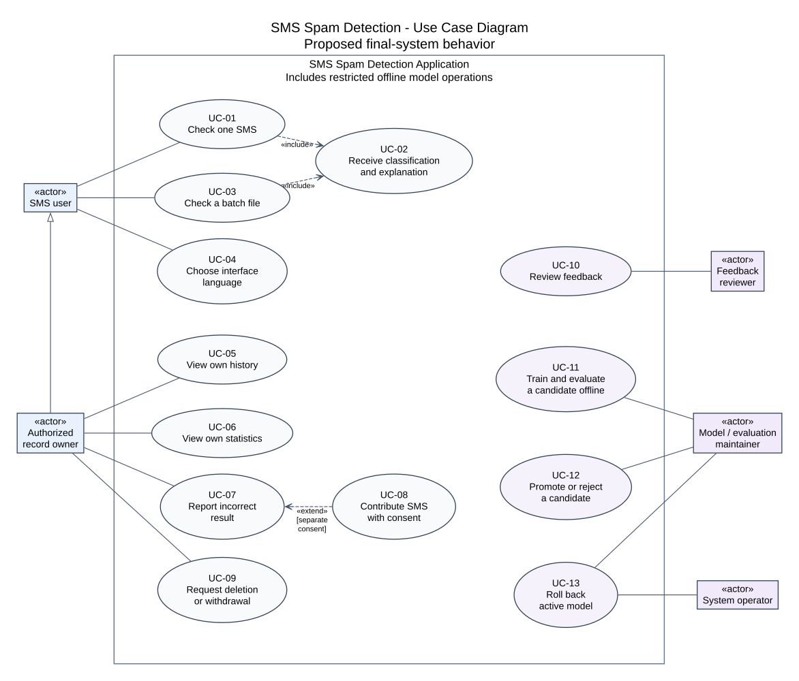

# Use Case Diagram and UX Scenarios

## 1. Purpose and design basis

This document specifies actors, user goals and observable interaction flows for **Development of a Web-Based SMS Spam Detection Application Using Machine Learning**, group SE-2425. Beknur Serikkali leads the UI/UX design; Sanzhar reviews API, authorization and privacy boundaries, and Rafael reviews feedback, statistics and the model lifecycle.

The scope follows the [Project Proposal](project_proposal.md), Sections 9–18, the [DIP-8 requirements baseline][requirements] and the published [System Context and Component architecture][architecture]. Requirement identifiers below refer to commit `2ce69c0889f639199fe0bd22efc57e7dc02358a6`; the requirements file was confirmed byte-for-byte unchanged in inspected GitHub main commit `e5ad6f8b6232ad8994ddfd579ac37173e7410d59`. The university's first pre-defense requirements call for aligned architecture, scenarios and requirements, with editable diagram sources and readable exports. Roadmap step **S13** requires the Use Case diagram and at least 4–5 scenarios with inputs, outputs and requirements links. S13 is a planning-step identifier; the corresponding confirmed task is [DIP-13 — Design Use Case diagram and UX scenarios](https://sms-spam-se2425.youtrack.cloud/issue/DIP-13), assigned to Beknur Serikkali.

These are proposed final-system interactions. No implemented application, measured classifier output, completed user study, peer approval or supervisor approval is established here. DIP-2 findings and requirements decisions D-01–D-08 may revise the design. Screen mockups and the clickable prototype belong to S15; actual usability/accessibility evaluation belongs to S18.

## 2. System boundary, actors and permissions

The system boundary includes public browser/API interactions and restricted feedback and offline model operations. The database, inference pipeline and frontend are internal components, not actors. Offline training is included in the overall project scope but remains outside public request execution. Dataset providers and the supervisor are stakeholders rather than runtime actors in this diagram.

| Actor | Goals and permission boundary |
|---|---|
| SMS user | Corresponds to the System Context's public SMS checker user. Manually check one message or a permitted batch, receive explanations and select an interface language. No inbox permission or account-registration workflow is implied. |
| Authorized record owner | Corresponds to the authorized history/session owner. Inherits SMS-user capabilities and may access only their authorized history, statistics, feedback and removal requests. This is a permission role; D-02 must define how a session/account proves ownership. An opaque prediction ID alone grants no access. |
| Feedback reviewer | Inspect permitted feedback evidence and record a review decision. Cannot treat a public correction or consent alone as a verified training label. Access to contributed text requires separate restricted authorization. |
| Model / evaluation maintainer | Conduct permitted offline training/evaluation and controlled model promotion/rejection/rollback, subject to the independent review gate and specific D-02/D-07 permissions. Model decisions do not follow from a public error report. |
| System operator | Configure, deploy, monitor and recover the service. Participates in UC-13 as operational recovery support, subject to authorization; this role alone does not grant model-evaluation or promotion approval. General configuration/monitoring is architectural context rather than a public UX scenario here. |

One person may hold several roles under explicit authorization. These roles do not reassign team responsibilities: Sanzhar leads API/storage/inference and deployment; Rafael leads model evaluation and feedback behavior; Beknur leads screens, data preparation and UX documentation.

Automatic inbox access, carrier blocking, URL fetching, guaranteed fraud prevention, public model uploads and immediate learning from public feedback remain outside scope.

## 3. Use Case diagram

Editable source: [use_case.dot](../diagrams/use_case.dot). Readable vector export: [use_case.svg](../diagrams/use_case.svg).

The diagram uses UML actor classifier notation: rectangles marked `«actor»`. Ovals are use cases; the enclosing rectangle is the system boundary. Solid lines show actor participation, without implying a sequence or data flow. The hollow-triangle generalization points from Authorized record owner to SMS user. UML notation follows the [OMG UML 2.5.1 specification][uml], Clause 18.

- **UC-01 and UC-03 include UC-02:** every successful single check, and every successful batch record, produces classification and explanation information. This does not mean validation failures must return a prediction or that a user must open every explanation. Unsupported explanation mapping is explicitly disclosed under FR-04/FR-05.
- **UC-08 extends UC-07:** optional text intake is inserted at the extension point **before feedback submission**, guarded by separate informed consent for the chosen contribution. UX-06 steps 1–2 describe the consent choice preceding that point; steps 3–5 describe the guarded intake/review handoff. UC-07 remains complete as metadata-only feedback when consent is declined. Contributing text is not required to report an error.
- Review, offline training, promotion and rollback are separate goals with preconditions. Their ordering is specified below rather than represented as `include` arrows. Input validation, rate limits and access checks constrain the flows; they do not become independent user goals.

| Use case | Actor | Observable goal | Scenario |
|---|---|---|---|
| UC-01 | SMS user | Check manually entered text | UX-01, UX-08 |
| UC-02 | SMS user through UC-01/UC-03 | Receive the label, score interpretation, versions and a faithful explanation or explicit limitation | UX-01, UX-02 |
| UC-03 | SMS user | Check a CSV/UTF-8 batch with complete record accounting | UX-02 |
| UC-04 | SMS user | Choose EN/RU/KZ interface text independently of model coverage | UX-03 |
| UC-05 | Authorized record owner | Inspect permitted metadata history | UX-04 |
| UC-06 | Authorized record owner | Inspect scoped, model-aware prediction counts | UX-04 |
| UC-07 | Authorized record owner | Flag a wrong result without retaining the SMS | UX-05 |
| UC-08 | Authorized record owner | Optionally contribute permitted text for review | UX-06 |
| UC-09 | Authorized record owner | Request deletion of owned records or withdrawal of a contribution | UX-07 |
| UC-10 | Feedback reviewer | Review evidence and record an auditable decision | OPS-01 |
| UC-11 | Model / evaluation maintainer | Train and evaluate a versioned candidate offline | OPS-02 |
| UC-12 | Model / evaluation maintainer | Promote or reject a candidate after the review gate | OPS-02 |
| UC-13 | Model / evaluation maintainer; system operator supports recovery | Restore a permitted compatible previous model | OPS-03 |

## 4. UX scenarios

Inputs below are synthetic design fixtures. Labels and probabilities are not asserted for these texts: future contract fixtures must supply independently checked expected outputs for a fixed model. All screens must support keyboard operation, associated labels/errors, visible focus, announced loading/status changes, readable multilingual wrapping and status text independent of color (NFR-12–NFR-14/NFR-20). Exact viewports, browser matrix and user-study criteria remain pending D-08.

### UX-01 — Check one SMS and interpret the explanation

**Actor / trigger:** SMS user selects Check after entering text. **Use cases:** UC-01, UC-02.

**Preconditions:** The service has a compatible active model; requested coverage follows D-03. The transient-processing notice and current language limitations are visible before submission. Saving metadata is limited to an authorized scope established under D-02.

**Input:** Synthetic message `The project meeting starts at 15:00.`; optional message-language evidence as defined by the future contract. UI locale is not a model-language declaration.

**Main flow:**

1. The user reads the processing notice and enters the SMS in a labelled text field.
2. The UI checks required input and displays the applicable agreed limits; the API enforces authoritative validation and resource limits.
3. On submission, the UI announces processing, prevents accidental repeated activation and avoids displaying an earlier result as the current one.
4. The service applies compatible privacy/Unicode preprocessing and the versioned model. The response correlates with this submission.
5. The result presents `spam` or `ham`, model-estimated spam probability, effective threshold/decision rule, confidence meaning and its validation limits, model/preprocessing and explanation/interpretation versions, and evaluated-language limitations.
6. The user inspects influential fragments mapped to actual model features. Protected spans stay hidden. The page explains that the prediction may be wrong and does not certify a message, link or sender as safe.
7. Where permitted metadata is saved, the UI distinguishes saved history from a transient result. The user can start another check or report an error.

**Output / postconditions:** One correlated result or an explicit failure; no raw SMS or text-bearing explanation in ordinary history/logs. Only authorized metadata may remain. Result text in the browser is temporary and is cleared when the user starts a new check/leaves the flow under the agreed retention design; no default localStorage/sessionStorage persistence is proposed.

**Alternative flows:** Empty, oversized or malformed input follows UX-08; unevaluated/mixed/undetermined text follows D-03 warning-versus-rejection policy. Missing explanation mapping is labelled as a limitation, with no invented highlight.

**Exception flows:** Model/service failure produces no fabricated score. If classification succeeds but persistence fails, the UI states the actual save outcome under D-04 and does not promise history availability. A lost connection or invalid response must not be presented as the current result. No automatic resubmission of SMS is implied; retry follows UX-08 and D-04.

**Requirements:** FR-01–FR-05, FR-09, FR-11, FR-18–FR-22; NFR-01, NFR-02, NFR-07, NFR-10, NFR-12, NFR-13, NFR-20. **Pending:** D-02–D-06, D-08.

### UX-02 — Submit a batch and account for every record

**Actor / trigger:** SMS user selects a file and starts a batch check. **Use cases:** UC-03, UC-02.

**Preconditions:** The UI exposes the agreed CSV/UTF-8 schema, quoting/multiline rules, required columns and configured file/record limits. D-04 fixes these values before implementation acceptance; this document does not approve a column name or numerical maximum.

**Input:** A permitted synthetic CSV fixture with stable logical record identifiers: English `The project meeting starts at 15:00.`, Russian `Встреча по проекту начнётся в 15:00.`, Kazakh `Жоба бойынша кездесу сағат 15:00-де басталады.`, an empty-message record and a quoted record containing a comma or embedded newline. These are five logical records, regardless of physical line count.

**Main flow:**

1. The user reads the format and privacy guidance, then selects the file using a keyboard-accessible file control.
2. The server validates file type, byte/record limits, UTF-8 and CSV structure before bounded processing.
3. The service maps parsed records to stable identifiers. Valid supported records receive predictions; each rejected record receives its own reason. The coverage policy applies independently to each record.
4. The UI presents processing/completion state, submitted/parsed/outcome counts with their definitions, and a table that distinguishes predictions from rejections.
5. The user opens a successful record's details to inspect score, versions, explanation and limitations, or uses its error reference to correct the source file.
6. Before any retry, the UI explains whether the original request completed, partially completed or has an unknown outcome. Retry behavior follows D-04 rather than silently rechecking successful records.

**Output / postconditions:** For a fully parseable completed batch, every logical record has exactly one terminal prediction or explicit rejection and counts reconcile. For the five-record fixture, all five must be accounted for; this is not a claim that the model supports every language. Raw uploads, row text and explanations are not retained in ordinary history/logs; temporary upload disposal follows D-05.

**Alternative flows:** Invalid decoding, unrecoverable CSV syntax, unsupported file type or excessive file size yields a file-level error, never a misleading completed table. A valid CSV with a missing/empty message has a record-level outcome under the agreed schema. A downloadable report is not assumed by this baseline.

**Exception flows:** An interrupted batch identifies unfinished/unknown outcomes and does not label them successful. Partial inference/storage failures remain visible. Network loss or an invalid/incomplete response does not establish completion or justify automatic resubmission; D-04 governs reconciliation and retry.

**Requirements:** FR-03–FR-07, FR-09, FR-11, FR-18–FR-22; NFR-01, NFR-05, NFR-07, NFR-08, NFR-10, NFR-12–NFR-14. **Pending:** D-03–D-06, D-08.

### UX-03 — Switch the interface language without changing model evidence

**Actor / trigger:** SMS user chooses English, Russian or Kazakh. **Use case:** UC-04.

**Preconditions:** Reviewed translations exist for core entry, error, result, batch, history and feedback states. Model coverage is supplied independently of interface locale.

**Input:** Existing synthetic SMS and, if available, a completed correlated result; interface selection EN → RU → KZ. Message-language codes remain `en`, `ru`, `kk`, `mixed`, `und`, `other` according to the data specification.

**Main flow:**

1. The user reaches the language selector by keyboard and selects a locale.
2. Labels, help, validation text, consent text and result descriptions change to the selected locale; focus remains usable.
3. The original SMS is neither translated nor resubmitted. An already received label, score, threshold and model version stay unchanged.
4. The evaluated-coverage notice remains visible. A Kazakh interface does not imply that Kazakh prediction quality has been established.

**Output / postconditions:** A consistent selected-language interface with the same underlying message and prediction evidence.

**Alternative flows:** If the underlying message is mixed, undetermined or unsupported, D-03 governs warning/rejection independently of the selected UI language. Any locale fallback must be explicit and reviewed.

**Exception flows:** Missing or failed-to-load translations block acceptance of the affected core state; the UI must not silently imply a complete successful language switch. Make the unavailable state and any reviewed fallback explicit, without changing or resubmitting the SMS or its model result. This flow does not require a new translation service.

**Requirements:** FR-08, FR-09; NFR-12–NFR-14, NFR-20. **Pending:** D-01, D-03, D-08.

### UX-04 — View private history and model-aware statistics

**Actor / trigger:** Authorized record owner opens History or Statistics. **Use cases:** UC-05, UC-06.

**Preconditions:** A valid ownership/session mechanism exists under D-02. Fixtures include two independent owners and metadata from at least two model versions.

**Input:** Current authorization context and any agreed filters/page cursor. A separate owner's record identifier is a negative fixture, not authorization.

**Main flow:**

1. The service derives the permitted scope from verified authorization and retrieves only that scope's metadata.
2. History shows opaque prediction IDs, time, label/score, threshold and agreed model/preprocessing versions. Raw SMS, sender details, full URLs and text-bearing explanations are absent.
3. The owner inspects a permitted item's metadata or follows bounded navigation if FR-23 is adopted. History cannot reconstruct the original message or its highlights.
4. Statistics shows scoped counts by predicted class and model version with clearly defined time/language filters, where supported.
5. The UI labels these as prediction statistics. It does not call a percentage of predicted spam precision, recall, F1 or measured accuracy.

**Output / postconditions:** Exact fixture-derived counts and owner-only records; access reveals no other owner's content.

**Alternative flows:** Empty history receives a useful empty state. Expired/missing authorization asks the user to re-establish the agreed access context; guessed/cross-owner IDs disclose no unauthorized record under D-02. Language filters use recorded message-language evidence rather than UI locale.

**Exception flows:** Database, service, network or response-validation failure produces a safe unavailable/error state rather than an empty-success history or invented zero counts. A previously loaded view must not be presented as a successfully refreshed result.

**Requirements:** FR-10–FR-12, FR-19, FR-22, FR-23 (Should); NFR-01, NFR-03, NFR-05, NFR-13, NFR-14. **Pending:** D-02, D-04, D-05, D-08.

### UX-05 — Report an incorrect result without contributing text

**Actor / trigger:** Authorized record owner selects Report incorrect result on an owned prediction. **Use case:** UC-07.

**Preconditions:** The prediction belongs to the current authorized scope. The metadata-only route is available independently of text-contribution consent.

**Input:** Owned prediction ID, incorrect-result flag and optionally proposed `spam`/`ham` correction; no retained SMS text.

**Main flow:**

1. The UI identifies the prediction and the version that produced it.
2. The user flags the result and may propose a corrected label. The form explains that this is a proposed correction for review, not an immediate model update.
3. The user declines or leaves unselected the separate text-contribution option. An existing transient message is not attached automatically.
4. The service verifies ownership and applies the agreed duplicate/idempotency rule.
5. The UI receives a correlated report identifier and review state, explicitly stating that no message text was contributed.

**Output / postconditions:** Metadata-only feedback is recorded safely. The active model is unchanged. A hash or prediction metadata is not sufficient to create a training example.

**Alternative flows:** Unauthorized or expired context is denied safely. Cancelling before submission creates no report. Text contribution, if chosen, follows UX-06 rather than overriding this route.

**Exception flows:** A failed or uncertain submission does not justify blind retry, duplicate reports or a false saved confirmation. Display the known report outcome and apply D-04 reconciliation/idempotency; no text is retained as a side effect.

**Requirements:** FR-13–FR-15, FR-19; NFR-01, NFR-03, NFR-04, NFR-10, NFR-20. **Pending:** D-02, D-04, D-05, D-08.

### UX-06 — Optionally contribute text with separate consent

**Actor / trigger:** Authorized record owner opts into the contribution extension before submitting feedback. **Use cases:** UC-07, UC-08.

**Preconditions:** UC-07's owned-prediction and valid authorization conditions hold; the user is in its feedback flow before submission. D-05 supplies approved purpose/notice, retention and withdrawal terms; D-02 restricts intake access. No real text collection starts before these arrangements exist. A historical metadata record cannot recover the original SMS.

**Input:** A permitted synthetic replacement/example text, proposed label and explicit consent tied to the relevant notice. The user may need to re-enter text if it is no longer present transiently.

**Main flow:**

1. The form explains the difference between reporting an error and retaining text for possible reviewed training use. Text contribution is optional and consent is not preselected.
2. The user reviews the permitted-use/retention/withdrawal notice, removes personal details from the proposed text and explicitly consents if they wish to proceed.
3. The service validates permission and routes contributed text to restricted intake, separate from ordinary history. Automatic masking does not establish anonymity or labeling correctness.
4. The UI confirms intake/review state without claiming that the text has been verified, added to training or used to update a model.
5. A reviewer later follows OPS-01; only permission-cleared, privacy-reviewed and independently confirmed examples may enter a versioned release.

**Output / postconditions:** Traceable consent/notice reference and restricted contribution state; no default publication permission and no live retraining.

**Alternative flows:** Declining consent returns to UX-05. Invalid/missing permission blocks text admission. Privacy-failed, uncertain, duplicate or unconfirmed examples remain excluded. Leaving/cancelling before submission must not retain unsubmitted text. A withdrawal request follows UX-07 and D-05.

**Exception flows:** If restricted intake or submission fails, distinguish the known metadata-report outcome from the text-contribution outcome; do not claim that either was saved without confirmation. Failure of the optional contribution must preserve the user's ability to send metadata-only feedback. Do not silently attach/retry text or invent a transaction/endpoint contract; D-04 fixes partial-failure and retry semantics.

**Requirements:** FR-13–FR-16; NFR-01, NFR-02, NFR-04, NFR-05, NFR-17, NFR-20. **Pending:** D-01, D-02, D-04, D-05, D-08.

### UX-07 — Request deletion or withdraw a contribution

**Actor / trigger:** Authorized record owner requests removal of owned metadata or withdrawal of an owned text contribution. **Use case:** UC-09.

**Preconditions:** D-02 verifies requester authority. D-05 defines allowed requests, retention, backup propagation, and the effects/limits for released datasets and trained models. No immediate model-unlearning promise is implied.

**Input:** Authorized record/contribution reference and requested action, without sending the SMS again.

**Main flow:**

1. The UI explains which retained information the request concerns and the approved consequences/limits before confirmation.
2. The service verifies scope and accepts the request under the agreed deletion/withdrawal policy.
3. The UI displays a correlated request state, distinguishing accepted/pending from completed.
4. After the defined process completes, the user receives the actual permitted outcome. Restricted recovery/restore processes must respect withdrawal safeguards.

**Output / postconditions:** A truthful authorized request/outcome; no guarantee beyond the resolved D-05 policy. Deletion must not expose or remove another owner's records.

**Alternative flows:** Cross-owner references are denied safely. Pending dependencies or already released artifacts are handled explicitly according to D-05, never reported as complete removal by assumption. The concrete controls and completion criteria remain pending until that policy is agreed.

**Exception flows:** Submission/network failure leaves the request outcome failed or unknown rather than accepted by assumption. Failed deletion/withdrawal propagation remains incomplete and is disclosed under D-05; no completed-removal confirmation is issued before the defined process succeeds. Recovery must not resurrect withdrawn data into active use.

**Requirements:** NFR-03–NFR-05; FR-19. **Pending:** D-02, D-04, D-05, D-07.

### UX-08 — Recover from invalid input or service failure

**Actor / trigger:** SMS user submits invalid input or encounters a failed request. **Use cases:** UC-01/UC-03 alternative flows, not a separate user goal.

**Preconditions:** Error codes, bounds and retry semantics are agreed under D-04/D-06; the server performs its own checks.

**Input:** Whitespace-only text, exactly-at/over-limit synthetic text/file, invalid UTF-8/CSV, wrong payload type, excess requests or an injected model/database/network failure.

**Main flow:**

1. The UI identifies the affected field, file or logical record with an accessible message and focus/status treatment.
2. A server rejection carries the agreed safe error code and correlation/record reference without echoing SMS, credentials or internal traces.
3. The UI offers the applicable action: correct input, re-establish authorization, wait for the documented rate window, or retry only according to the known request outcome.
4. The user corrects the issue and starts a permitted request. An unresolved earlier response is not displayed as a successful prediction for new input.

**Output / postconditions:** No fabricated label, no silently lost batch records, no unsafe automatic retry and no false promise that history/feedback was saved.

**Alternative flows:** Client-side validation cannot replace API enforcement. Field/row errors, expired authorization and rate limits lead to their documented correction, access or wait actions. Exact HTTP/status mappings and numerical limits remain pending rather than being invented here.

**Exception flows:** A disconnected client may not know whether the server completed; show uncertainty and apply D-04 idempotency/reconciliation. An unavailable dependency or invalid response must not be misrepresented as user error. Repeated failure keeps an explicit error/unknown state, with no fabricated result or unsafe automatic retry.

**Requirements:** FR-07, FR-18–FR-20; NFR-02, NFR-03, NFR-07, NFR-08, NFR-10, NFR-13. **Pending:** D-02, D-04, D-06, D-08.

## 5. Restricted operational scenarios

These describe authorized operations; they do not require public administration pages or extend Beknur's leading duties into Rafael's model pipeline or Sanzhar's deployment work.

| Scenario / use cases | Preconditions and input | Main flow and output | Alternative flows | Exception flows | Requirements |
|---|---|---|---|---|---|
| OPS-01: Review feedback / UC-10 | Authorized reviewer opens a permitted report; permission reference and allowed evidence are available; text may be absent | Review provenance/permission/privacy and independent label evidence under the [Annotation Guidelines](annotation_guidelines.md); record accept/reject/unresolved decision, reviewer, time and evidence without erasing earlier decisions | Metadata-only feedback cannot become text-bearing training data; consent alone cannot confirm a label. Public self-approval is denied; unresolved/privacy-failed examples are withheld | Missing/inaccessible evidence or failed decision persistence leaves review unresolved/unsaved; no verified-label or training-release confirmation is fabricated | FR-15, FR-19; NFR-04, NFR-05, NFR-10, NFR-17 |
| OPS-02: Evaluate and decide on a candidate / UC-11, UC-12 | Authorized model/evaluation maintainer initiates an offline run/decision; versioned cleared/confirmed data, protected splits, trusted artifacts and agreed D-03 evaluation gate | Run training/evaluation offline; record configuration, per-language evidence and compatibility checks. A separate authorized decision promotes or rejects the evaluated artifact under the agreed review gate | Public requests/feedback never start training. Leakage or permission failures block the release; failed evaluation/compatibility leaves the current model active. Promotion cannot assume all workers changed atomically | Interrupted training, missing/corrupt artifacts or failed activation/readiness does not establish a completed/promoted candidate; D-07 governs safe failure/recovery and records actual served versions | FR-16, FR-17, FR-19, FR-21, FR-22; NFR-04, NFR-10, NFR-15, NFR-17–NFR-19; EV-01 |
| OPS-03: Roll back a model / UC-13 | Authorized model/evaluation maintainer initiates rollback with separately authorized system-operator recovery support; permitted integrity-checked compatible previous artifact and D-07 procedure | Record the authorized model-selection decision, restore the approved artifact/configuration through restricted operational controls, verify readiness and record actual versions served; history preserves the original prediction versions | An unavailable, incompatible or disallowed prior artifact blocks rollback; system-operation privileges alone cannot approve a different model | Failed restoration, readiness or version agreement leaves recovery incomplete and follows D-07 safe failure handling; do not claim a healthy/completed rollback or resurrect withdrawn data | FR-17, FR-19, FR-22; NFR-04, NFR-05, NFR-10, NFR-11, NFR-18, NFR-19 |

Review acceptance, training-release admission and model promotion are different decisions. Feedback review, model maintenance and system operation have distinct permissions. Model-quality reports under EV-01 remain restricted evaluation evidence, not measured-accuracy claims derived from public history.

## 6. Requirements and handoff traceability

This matrix maps interactions to requirements; it does not replace the full specification or assert that diagram coverage verifies an implementation.

| Requirement group | Use cases / scenarios | Planned visible evidence or check |
|---|---|---|
| FR-01–FR-05, FR-21, FR-22 | UC-01/UC-02; UX-01, OPS-02 | Versioned result, independently checked contributions/offsets, score meaning and privacy-compatible preprocessing |
| FR-06, FR-07, FR-18–FR-20 | UC-03; UX-02, UX-08 | Logical-row accounting, file/record errors, bounded input and honest partial/persistence outcomes |
| FR-08, FR-09; NFR-12 | UC-04 and all result flows; UX-01–UX-03 | All core locales; unchanged inference evidence on locale switch; explicit coverage policy |
| FR-10–FR-12, FR-23; NFR-03 | UC-05/UC-06; UX-04 | Two-owner access checks, metadata-only history and exact seeded model-aware counts |
| FR-13–FR-15; NFR-04 | UC-07/UC-08/UC-10; UX-05/UX-06, OPS-01 | Separate consent-declined/accepted routes, restricted review and preserved decision history |
| FR-16, FR-17; NFR-17, NFR-18; EV-01 | UC-11–UC-13; OPS-02/OPS-03 | Offline run/evaluation evidence, reviewed candidate decisions, version-consistent activation/rollback |
| NFR-01, NFR-02, NFR-05, NFR-06 | All submissions; UC-09; UX-01/UX-02/UX-06/UX-07 | Retention/data-flow inspection, safe logs/errors, HTTPS and authorized removal/withdrawal outcomes |
| NFR-07–NFR-11 | UX-02/UX-08, OPS-03 | Agreed boundary/load/failure/recovery checks; no assumed latency or availability result |
| NFR-13, NFR-14, NFR-20, NFR-22 | All public UX flows | Keyboard, responsive/browser and comprehension checks under D-08; real observations remain future work |
| NFR-15, NFR-16, NFR-19, NFR-21 | Public/restricted boundary; OPS-01–OPS-03 | Component/contract tests, clean deployment and restricted diagnostics under the respective owners |

### 6.1. Architecture alignment record

The read-only remote inspection on **24 October 2026** found branch `DIP-10-system-architecture` at `d7041cc64e851cfda1ecfd463a4f6ba363933340` and GitHub main at `e5ad6f8b6232ad8994ddfd579ac37173e7410d59`. GitHub reported no open Pull Requests at that inspection. [Architecture PR #7][architecture-pr] was closed and merged; the branch commit is an ancestor of the inspected main. This identifies the architecture actually compared, rather than assuming an open S12 PR or a task completion state.

The inspected files are [architecture.md][architecture], [system_context.dot][context-source], [component.dot][component-source] and their SVG exports at that immutable main commit. The following comparison records document-level alignment; it does not establish application integration or approval by the component owners.

| Published architectural boundary / node names | S13 correspondence | Comparison result |
|---|---|---|
| System Context `public_user`, `owner`, `reviewer`, `maintainer`, `operator` | Five human actors; UC-01–UC-13 and OPS-01–OPS-03 | Roles preserved; model/evaluation maintenance and system operation are explicitly separated. Owner specialization models the owner acting as a checker, without requiring checker privileges for every operational role |
| System Context `provider`; Component `data`, `corpus` | Dataset Strategy and restricted preparation before OPS-02 | The provider remains a permitted offline data interface. No public corpus-upload or dataset-administration screen is introduced; not every context interface needs a public UX scenario |
| `ui` → `api` → `prep` → `infer` | UX-01/UX-02/UX-03/UX-08; UC-01–UC-04 | Same transient text/Unicode/masking/span flow, model-derived result and explicit coverage/error states; UI never accesses PostgreSQL or the artifact store directly |
| `api` → `history` / `feedback` → `pg` | UX-04/UX-05; UC-05–UC-07 | Owner-scoped metadata and prediction statistics only; raw SMS and text explanations are excluded, and error flags do not become training examples |
| `api` → `gate` → `contributions` → gated `data` release | UX-06, OPS-01; UC-08/UC-10 | Separate consent, restricted/quarantined text, privacy review and confirmed labels precede release; declining consent preserves metadata-only feedback |
| `corpus` → `training` → candidate `artifacts`; `promotion` and approved loading into `infer` | OPS-02/OPS-03; UC-11–UC-13 | Offline evaluation and authorized activation/rollback stay separate from public checking. A saved candidate is not automatically active; each response retains effective versions |
| `operations`, retention/deletion and recovery boundaries | UX-07/UX-08, OPS-03; UC-09/UC-13 | Removal/withdrawal remains policy-dependent; restore/rollback must respect restrictions. Operator recovery support does not bypass the model decision gate |

The `snapshot` System Context, Component sources and architecture text from the 23 October backup were also read as a preliminary comparison. They share the browser → API → inference and offline-artifact structure, but refer to optional metadata storage and anonymous history and do not detail current role/consent boundaries. The published architecture and current FR-10–FR-17/NFR-03–NFR-05 take precedence: history/statistics remain final-scope requirements, ownership is explicit, and contributed text is segregated. The backup's example routes and schema values have not been adopted as approved API contracts. No backup architecture files were copied into the working architecture or main.

**S12 follow-up (Sanzhar):** Confirm this actor/data-boundary mapping in a real review. Endpoint names, session mechanism, schema, file limits and D-01–D-08 remain open as in the published architecture. Recheck alignment if those diagrams or contracts change after the recorded commit; no owner or supervisor approval is inferred from this comparison.

**S14 handoff (Rafael):** Review metadata-only versus text-bearing feedback, independent label confirmation, source/duplicate/evaluation-group checks, offline retraining and candidate/rollback evidence. Record actual findings and changes; no completed review is implied.

**S15 handoff (Beknur):** Prepare entry/result/explanation, file validation and mixed batch outcomes, locale/coverage states, empty/expired history and statistics, metadata-only feedback, optional consent/intake, and a policy-dependent removal request state. Use synthetic fixtures visibly marked as mock output. Actual screenshots must come from the opened prototype.

**S18 handoff (Beknur):** Agree D-08 task/viewport/browser and comprehension criteria, then assess keyboard navigation, failure recovery, explanation/coverage interpretation and consent understanding. The written scenarios are task inputs, not user-study results.

## 7. Design acceptance and remaining decisions

| S13 acceptance item | Artifact / evidence |
|---|---|
| Editable Use Case diagram plus readable export | [DOT source](../diagrams/use_case.dot), [SVG export](../diagrams/use_case.svg), [rendering instructions](../diagrams/README.md) |
| Actors and principal goals | Sections 2–3: single SMS, explanation, batch, locale, history/statistics, feedback and restricted lifecycle |
| At least 4–5 input/output scenarios | Eight UX scenarios with input, output, main/alternative flows; three operational scenarios |
| Links to requirements | Per-scenario IDs and Section 6 use the recorded DIP-8 baseline |
| Architecture alignment and truthful status | Section 6.1 records comparison against published System Context/Component sources at the inspected commit; unresolved D-01–D-08, peer/ML/supervisor review and real application/UX tests remain pending |

Acceptance of the design artifacts does not satisfy all university sections by itself. The other two diagrams, actual prototype, evaluation plan, user-relevance evidence and substantive supervisor feedback remain separate deliverables. To close the real task, attach its actual artifact/PR links and a genuine teammate review; no issue number, approval, test outcome or completion date is invented.

## 8. Supporting sources

- [Project Proposal](project_proposal.md): scope, responsibilities, privacy and model lifecycle.
- [DIP-8 requirements baseline][requirements]: FR/NFR/EV identifiers and pending D-01–D-08 decisions.
- [Published architecture][architecture], [System Context source][context-source] and [Component source][component-source]: current role, component and data-flow alignment; delivered through [architecture PR #7][architecture-pr].
- [Dataset Strategy](dataset_strategy.md) and [Annotation Guidelines](annotation_guidelines.md): privacy transformation, language buckets, permission and independent labeling rules.
- [Literature Review](literature_review.md): explanation/calibration and evidence limitations.
- [OMG UML 2.5.1][uml], Clause 18: actors, system subjects, use cases, include and extend relationships.

[requirements]: https://github.com/SanzharS1/sms-spam-detection/blob/2ce69c0889f639199fe0bd22efc57e7dc02358a6/docs/requirements.md
[architecture]: https://github.com/SanzharS1/sms-spam-detection/blob/e5ad6f8b6232ad8994ddfd579ac37173e7410d59/docs/architecture.md
[context-source]: https://github.com/SanzharS1/sms-spam-detection/blob/e5ad6f8b6232ad8994ddfd579ac37173e7410d59/diagrams/system_context.dot
[component-source]: https://github.com/SanzharS1/sms-spam-detection/blob/e5ad6f8b6232ad8994ddfd579ac37173e7410d59/diagrams/component.dot
[architecture-pr]: https://github.com/SanzharS1/sms-spam-detection/pull/7
[uml]: https://www.omg.org/spec/UML/2.5.1/PDF
